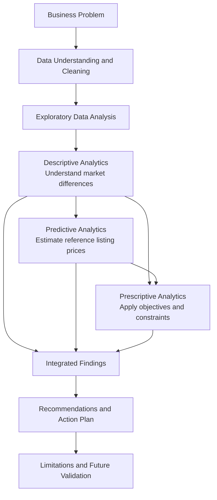

# CMCE30005-Renascence Project Plan 
Our group is group 4

# CMCE30005 Business Analytics Challenge
## Group4-Renascence - AIRBNB

**Subject:** CMCE30005 Business Analytics Challenge, Semester 2 2026
**University:** University of Melbourne
**Team Members:** Qihang Sun, Loc Le

---

## 1. Project Objective

### Background 

- **Background**  We are engaged by a client who intends to list multiple properties on Airbnb in Melbourne. We will act as their business analytics consultant.

- **Goal** goal of the project is supporting suggestions to our client who leases residential properties and runs them as Airbnb accommodation. 

- **Introduction about client**. A small operator preparing to list or manage short-term rental properties in Melbourne. The client needs to decide which accommodation product to launch first, what price to test, and which selling points to highlight.

Develop an evidence-based recommendation covering:

- **Product:** property type, guest capacity and accommodation experience.
- **Positioning:** amenities, photographs and listing-message priorities.
- **Launch price:** an initial nightly price supported by comparable listings and a pricing model.
- **Stay rules:** an initial minimum-stay requirement.
- **Validation:** adjustments based on actual booking and cost information.

The project focuses on existing properties or properties being considered for management. It does not estimate property acquisition returns.

---

## 2. Business Problem and Challenges 

**Our problem will be: For small operators preparing to list or act as agents for Airbnb listings in Melbourne, how can they select appropriate rental products based on market data and determine the initial listing price and operation plan?**

### 2.1 Problem Split

Here will be our research questions that how we split our research problem step by step

| Questions | Methods |
| :--- | :--- |
| Which accommodation products are worth considering? | Comparison of locations, property types, bedroom counts, and guest capacities|
| Which markets show historical review activity, and which experiences could be highlighted as selling points? | Analysis of review activity and guest-experience keywords |
| What reference price is appropriate for a specified property? | Listing-price prediction model |
| Under the defined conditions, which option should be tested first, and at what initial price? | Candidate screening and trial-pricing rules |

### 2.2 Challenges

- **1** Our project focuses on product positioning and initial listing prices, as the model predicts advertised prices rather than bookings or profits. It therefore provides a pricing reference but cannot identify the most profitable option.

- **2** Using the same average price across regions ignores differences in property type, guest capacity, and experience. Choosing a region solely for its high listing prices can also overlook competition and review activity. The client therefore needs a clearly justified, actionable plan that can be refined using actual booking results.

- **3** Our client has limited funds, so poor choices can tie up their money, and the rent is difficult to adjust after signing a lease.

---

## 3. Data Sources

| Dataset | What Each Record Represents | Information Used in This Project | Corresponding Analysis |
| --- | --- | --- | --- |
| `listings` | A snapshot of one property listing | Location, coordinates, property type, bedrooms, guest capacity, amenities, pricing dates, and price | Describe the market and build a listing-price prediction model |
| `reviews` | One guest review | Review date, listing ID, and guest-experience keywords | Analyse review activity and guest-experience themes |
| `calendar` | One day for one listing | Availability indicator and minimum/maximum stay requirements | Describe stay rules and inform pilot settings |

**Reasons for variable selection:** Location and property type define comparable property groups. Bedrooms, guest capacity, bathrooms, and amenities support pricing. Reviews inform product positioning, while calendar data inform stay rules. Identifiers are used only to link datasets and are excluded from predictive features.

#### Data Understanding, Cleaning, and Exploration

The data stage consisted of three main tasks:
- Understanding the available datasets and their purposes.
- Cleaning and preparing the data for analysis.
- Exploring data quality and distributions to guide subsequent methods.

#### Data Sources

The project used Melbourne Airbnb data from June 2026, consisting of three datasets:

| Dataset | Unit of Observation | Main Information | Purpose |
|---|---|---|---|
| listings | One property | Location, property type, capacity, bedrooms, bathrooms, amenities, listing price, and quotation dates | Market comparisons and price prediction |
| reviews | One guest review | Property ID, review date, and review text | Review activity and accommodation experience themes |
| calendar | One property on one date | Availability, minimum stay, and maximum stay | Analysis of stay requirements |

#### Dataset Size and Linkage

- The listings dataset contained **25,728 properties and 90 variables**.
- The reviews dataset contained **1,026,690 reviews**.
- The datasets were linked using the property ID.

#### Interpretation of the Data

- Listing prices do not necessarily represent actual transaction prices.
- Review counts do not directly represent booking volumes.
- Unavailable calendar dates do not necessarily indicate confirmed bookings.

### 3.2 Data Cleaning and Preparation

#### Property ID Checks

- Checked for missing and duplicate property IDs.
- No missing or duplicate property IDs were found in this dataset.
- The cleaning logic retains the most recently scraped record if duplicates exist.

#### Price and Numeric Conversion

- Removed currency symbols and commas from price values.
- Converted prices, bedroom counts, guest capacity, and other relevant fields into numeric values.
- Extracted bathroom counts from bathroom descriptions.

#### Date Processing

- Converted date fields into date formats.
- Calculated:
  - The number of nights covered by each quotation.
  - The number of days between scraping and the quoted check-in date.

#### Property and Amenity Classification

- Grouped properties into four categories:
  - Apartments.
  - Houses and townhouses.
  - Cottages and guest accommodation.
  - Other property types.
- Created amenity indicators for features such as:
  - WiFi.
  - Kitchens.
  - Free on-site parking.
  - Self check-in.
  - Pools.
  - Fireplaces.
  - Gardens.
  - Air conditioning.

#### Missing Value Treatment

- Missing prices were not replaced with zero.
- Properties without prices remained available for supply analysis but were excluded from price modelling.
- Other numeric values requiring imputation were handled within the model training pipeline to avoid data leakage.

#### Review Preparation

- Applied a consistent **365-day review window**, from **17 June 2025 to 16 June 2026**.
- Aggregated review counts and theme mentions by property.
- Assigned zero recent reviews to properties with no matched reviews within the window.
- Identified the following themes using English keywords:
  - Walking and transport.
  - Peacefulness and nature.
  - Families and children.
  - Couples and celebrations.
  - Work and business.
- Theme measures captured keyword mentions only; they did not measure sentiment.

### 3.3 Defining the Analysis Scope

The sample was progressively restricted to properties relevant to the business problem.

| Filtering Stage | Properties Retained |
|---|---:|
| Original property records | 25,728 |
| Properties captured in the current city scrape | 18,885 |
| Entire homes and apartments | 14,252 |
| Properties meeting the mainstream short-stay criteria | 10,182 |

The mainstream short-stay criteria were:

- Nightly listing price between **AUD 20 and AUD 2,000**.
- **1–3 bedrooms**.
- Capacity for **1–8 guests**.
- Minimum stay of **1–7 nights**.
- Quoted stay duration of **1–7 nights**.
- Quoted check-in date **0–30 days after scraping**.

Two main analysis samples were established:

- **14,252 properties** for analysis of the entire-property market.
- **10,182 properties** for comparable-price analysis and predictive modelling.

### 3.4 Visualizations and Deliverables

Here will be a discription about the main charts and graphs we posted in the output.
| Deliverable | Purpose |
|---|---|
| **Property distribution map** | Show the geographic distribution of accommodation types |
| **Comparable-price map** | Compare similar two-bedroom apartments across areas |
| **Product location map** | Present the locations of proposed launch plans |
| **Market comparison charts** | Explain supply, prices, review activity and amenities |
| **Calendar and activity charts** | Explain stay rules and historical review fluctuations |
| **Model evaluation charts** | Compare model performance with pricing baselines |
| **Product recommendation cards** | Specify product features, launch prices and stay rules |
| **30-day action plan** | Guide monitoring and price adjustments |

### 3.5  Exploratory Data Analysis (EDA)

#### Missing Data Assessment

Missingness was assessed across the original property sample.

| Variable | Missing Percentage |
|---|---:|
| Nightly listing price | 25.47% |
| Bedrooms | 18.19% |
| Parsed bathroom count | 0.10% |
| Area | 0.00% |

Implications:

- Different analyses required different sample definitions.
- Properties without prices could still contribute to supply analysis.
- Price comparisons required valid price information.

#### Price Distribution

For properties with positive prices in the current city scrape of entire homes and apartments:

- Mean nightly listing price: **AUD 367.81**.
- Median nightly listing price: **AUD 280.06**.
- Maximum nightly listing price: **AUD 23,149.50**.

The distribution had a long right tail:

- A small number of expensive properties increased the mean.
- The median provided a more representative measure for market comparisons.
- Subsequent analysis used medians and quartiles to describe comparable prices.

#### Implications for Subsequent Analysis

- Comparable property groups were defined using:
  - Area.
  - Property type.
  - Number of bedrooms.
  - Guest capacity.
- These groupings reduced the influence of differences in property composition.
- Market comparisons and modelling used explicitly defined samples.

### 3.6 Outputs of the Data Stage

The data stage produced:

- Cleaned and linked property-level data.
- Standardised numeric, date, property-type, and amenity variables.
- Review measures based on a consistent observation window.
- Clearly defined samples for market analysis and price modelling.
- Evidence supporting the use of medians, quartiles, and comparable property groups.

At this stage, no final location selection or launch price had been determined.

---

## 4. Analysis Roadmap 

### 4.1 Analysis Roadmap

Our analysis moves from defining the business problem to preparing the data, conducting descriptive, predictive, and prescriptive analysis, and developing operational recommendations.

The “existing four-person property” and “existing woodland property” are conditional client scenarios, not facts verified by the data.

### Overall Analysis Process

| Stage | Key Question | Methods | Main Output |
|---|---|---|---|
| **Business Problem** | Which rental product, initial price, and operating approach should be selected? | Define client objectives, scope, and conditional scenarios | A focused decision problem |
| **Data Understanding and Cleaning** | Which data are usable, and how can they be made consistent? | ID checks, type conversion, missing-value treatment, property and amenity coding, data linkage, time windows, and sample filtering | Prepared analysis datasets |
| **Exploratory Data Analysis** | What are the main data characteristics? | Missingness statistics, descriptive statistics, price histograms, and comparisons by bedroom count | Justification for medians and comparable property groups |
| **Descriptive Analytics** | How do locations and accommodation products differ? | Maps, grouped statistics, medians and quartiles, review keyword analysis, amenity proportions, calendar rules, and monthly trends | Evidence about market conditions and product positioning |
| **Predictive Analytics** | What is a suitable reference listing price for a specified product? | Host-grouped data splitting, regression models, baseline comparisons, and permutation importance | Evaluated pricing model and candidate predictions |
| **Prescriptive Analytics** | Which option meets the objectives and constraints? | Rule-based filtering, candidate ranking, constrained price selection, and sensitivity analysis | Conditional product choices, trial prices, and stay settings |
| **Integrated Findings** | How do the three types of analysis support the conclusions? | Connect market facts, model predictions, and decision rules | A traceable evidence chain |
| **Recommendations and Limitations** | How should the recommendations be implemented and validated? | Product cards, a 30-day action plan, price testing, financial scenarios, and limitations assessment | Operational actions and future evaluation measures |

### 4.2 Descriptive Analytics: Understand Market Differences

- **Geography and supply:** Map property locations and compare supply and property-type proportions across areas.
- **Comparable prices:** Group properties by area, property type, bedrooms, and capacity; compare median prices and quartiles.
- **Review activity:** Use a common 365-day window and, where relevant, properties with at least one year of review history.
- **Review themes:** Use English keyword matching to measure mentions of transport, nature, families, and other themes.
- **Amenities:** Compare the prevalence of pools, fireplaces, parking, gardens, and other facilities.
- **Stay rules and time patterns:** Analyse two-night stay rules within a 90-day calendar window and monthly review activity for a fixed property cohort.

### 4.3 Predictive Analytics: Estimate Reference Listing Prices

- **Target:** Nightly displayed listing price.
- **Inputs:** Area, property type, bedrooms, capacity, bathrooms, amenities, and quotation conditions.
- **Data splitting:** Group by host ID to prevent the same host’s properties from appearing across training and test sets.
- **Preprocessing:** Apply numeric imputation, standardisation, and categorical one-hot encoding within the training pipeline.
- **Models compared:**
  - Log-target ridge regression.
  - Random forest.
  - Gradient boosting.
- **Model selection:** Select the model with the lowest validation MAE; gradient boosting was selected.
- **Evaluation:** Compare test performance against an overall median price and an area-by-bedroom median price.
- **Interpretation:** Use permutation importance to identify which information the model relies on.
- **Candidate quotations:** Fix the month, lead time, check-in day type, and stay duration to generate comparable reference prices.

### 4.4 Prescriptive Analytics: Turn Evidence into Decisions

- **Eligibility checks:** Require sufficient comparable properties, review-history samples, and two-night quotations.
- **Scenario rules:**
  - **Urban one-bedroom pilot:** Among candidates meeting the review-activity threshold, select the area with the highest median listing price.
  - **Conditional four-person property:** Among eligible two-bedroom markets, select the area with the highest median annual review count.
  - **Conditional woodland property:** Use the assumed existing location and specified amenities to generate a quotation.
- **Trial price selection:** Within the comparable market’s 25th–75th percentile price range, choose the AUD 10 price increment closest to the model prediction.
- **Sensitivity analysis:** Change the review-activity threshold and check whether the preferred urban location changes.

### 4.5 Scope of the Analysis

- The project supports product selection and initial listing decisions.
- The model predicts listing prices.
- The decision rules align recommendations with stated objectives and constraints.
- The project does not establish profit-maximising prices.

### 4.6 Flowchart

---

## 5. Descriptive Analysis

### 5.1 Purpose and Methods

- Examine differences across Melbourne’s short-term rental markets.
- Provide evidence for product selection, positioning, and operating settings.
- Use:
  - Descriptive statistics.
  - Group comparisons.
  - Geographic visualisation.
  - Review keyword matching.
  - Amenity proportions.
  - Monthly trend analysis.
- No machine learning, sentiment analysis, or time-series forecasting models were used in this section.

### 5.2 D1: Geographic Distribution and Property Types

- **Objective:** Identify where entire properties are concentrated and which accommodation types dominate.

- **Methods:**
  - Plot property coordinates on administrative maps.
  - Count properties by area.
  - Calculate property-type proportions.

- **Key findings:**
  - Approximately 97% of entire properties in the Melbourne administrative area were apartments.
  - In Yarra Ranges, approximately 41% were cottages or guest accommodation, and 45% were houses or townhouses.

- **Limitation:** Property counts measure supply, not demand.

### 5.3 D2: One-Bedroom Apartment Comparisons

- **Objective:** Compare listing prices and review activity across urban markets.

- **Methods:**
  - Select the four areas with the largest apartment supply.
  - Compare one-bedroom apartments accommodating 2–3 guests.
  - Calculate median listing prices.
  - Compare median review counts within a common 365-day window, using properties with at least one year of review history.
- **Key findings:**

| Area | Median Listing Price (AUD/Night) | Median Annual Review Count |
|---|---:|---:|
| Melbourne | 208 | 16 |
| Yarra | 232 | 17 |
| Port Phillip | 206.7 | 11 |
| Stonnington | 203 | 12 |

- **Implication:** Yarra combined a roughly 12% higher median listing price than Melbourne with similar review activity, supporting its inclusion in later candidate selection.

- **Limitation:** Review activity does not directly measure bookings.

### 5.4 D3: Bedrooms, Location, and Per-Person Prices

- **Objective:** Examine how prices and review activity vary by location and property size.

- **Methods:**
  - Map prices for two-bedroom apartments accommodating 4–5 guests.
  - Display areas only when at least 30 comparable properties are available.
  - Compare median prices and review counts by area and bedroom count.
  - Divide median listing prices by assumed guest numbers to illustrate per-person prices.

- **Key findings:**
  - Melbourne two-bedroom apartments: AUD 288 per night, or AUD 72 per person for four guests.
  - Melbourne one-bedroom apartments: AUD 208 per night, or AUD 104 per person for two guests.
  - Median annual reviews were higher for two-bedroom than one-bedroom apartments in Melbourne, but lower in Yarra.

- **Limitation:** Per-person prices are illustrative calculations, not observed guest payments.

### 5.5 D4: Review Themes and Amenities

- **Objective:** Identify differences in review topics and local amenity provision.

- **Methods:**
  - Match English theme keywords using regular expressions.
  - Calculate theme mentions as a proportion of non-empty reviews.
  - Calculate amenity availability as a proportion of entire properties.
  - Compare areas using grouped bar charts.

- **Key findings:**
  - Walking and transport appeared in approximately 27% of Melbourne reviews and 10% of Yarra Ranges reviews.
  - Peacefulness and nature appeared in approximately 5% and 35%, respectively.
  - Approximately 62% of Melbourne entire properties listed a pool.
  - Approximately 54% of Yarra Ranges entire properties listed a fireplace, and 91% listed free on-site parking.

- **Implication:** Urban products can emphasise convenience, while woodland products can emphasise nature and relevant holiday amenities.

- **Limitations:**
  - Keyword mentions do not establish positive sentiment.
  - Amenity prevalence does not demonstrate a causal price premium.

### 5.6 D5: Stay Rules and Monthly Review Activity

- **Objective:** Assess market support for two-night stays and examine changes in review activity.

- **Methods:**
  - Analyse calendar records from 17 June to 14 September 2026.
  - Calculate the proportion of available dates whose daily rules permit a two-night stay.
  - Track monthly reviews per 100 properties using a fixed cohort with sufficient review history.
  - Exclude incomplete months and display trends using line charts.
- **Key findings:**

  - Daily rules permitted two-night stays on approximately:
    - 70% of available dates in Melbourne.
    - 59% in Yarra.
    - 95% in Yarra Ranges.
  - Review activity varied across months.

- **Implication:** A two-night minimum stay provides an initial operating option to test.

- **Limitations:**
  - The analysis did not check availability for two consecutive nights.
  - Unavailable dates do not necessarily indicate bookings.
  - Monthly patterns were described, not forecast.

### 5.7 Outputs

- Urban apartment candidates for further evaluation.
- Review-activity benchmarks.
- Evidence for differentiated product positioning.
- Market references for minimum-stay settings.
- Inputs for subsequent price prediction and rule-based decision-making.

---

## 6. Predictive Analysis

### 6.1 Purpose

- Estimate reference nightly listing prices for specified accommodation products.
- Compare alternative models and assess whether they outperform simple pricing rules.
- Generate candidate quotations for the subsequent prescriptive analysis.
- Predict displayed listing prices, rather than future transaction prices, occupancy, or profit.

  **Models Used**

| Model | Target Treatment | Purpose |
|---|---|---|
| Ridge regression | Log-transformed price; predictions converted back to AUD | Provide a regularised linear benchmark |
| Random forest regression | Log-transformed price; predictions converted back to AUD | Capture nonlinear relationships and interactions |
| Histogram-based gradient boosting | Original price scale, using absolute-error loss | Capture nonlinear relationships while directly targeting absolute pricing error |

- Trained all three models on the same training set.
- Compared their performance on the same validation set.
- Selected the model with the lowest validation **Mean Absolute Error (MAE)**.

  **Model Selection**

| Model | Validation MAE (AUD) | Validation MedAE (AUD) | Predictions Within 25% |
|---|---:|---:|---:|
| Log-target ridge regression | 79.30 | 52.16 | 60.5% |
| Random forest | 79.23 | 46.51 | 61.8% |
| Gradient boosting | 76.24 | 46.91 | 63.4% |

- **Gradient boosting was selected** because it achieved the lowest validation MAE.
- The selected model was refitted on the combined training and validation sets.
- Final performance was assessed on the held-out test set.

### 6.2. Data and Variables

  **Modelling Sample**

- Used **10,182 entire properties** meeting the project's mainstream short-stay criteria.
- Restricted the sample by price, bedrooms, capacity, minimum stay, quoted stay duration, and booking lead time.

The variables below will be used for all the three models

  **Dependent Variable**

| Variable | Description |
|---|---|
| `price_aud` | Nightly displayed listing price in AUD |

  **Independent Variables**

| Category | Variables | Description |
|---|---|---|
| Property size | `bedrooms`, `accommodates`, `bath_num` | Bedrooms, guest capacity, and parsed bathroom count |
| Location | `area` | Administrative area |
| Property category | `property_group` | Apartment, house/townhouse, cottage/guest accommodation, or other |
| Stay requirement | `minimum_nights` | Minimum permitted stay |
| Quotation conditions | `quote_nights`, `quote_lead` | Quoted stay duration and days between scraping and check-in |
| Check-in timing | `quote_weekend`, `quote_month` | Weekend check-in indicator and check-in month |
| Amenities | 12 binary indicators | Whether each listed amenity is present |

The amenity indicators covered:

- WiFi.
- Kitchen.
- Free on-site parking.
- Self check-in.
- Pool.
- Fireplace.
- Hot tub.
- Pets allowed.
- Dedicated workspace.
- BBQ.
- Garden or backyard.
- Air conditioning.

  **Other Variables**

- **`host_id`:** Used to group properties when splitting the data; not used as a predictor.
- **Property ID:** Used for data linkage; not used as a predictor.
- **Review counts and themes:** Used in descriptive analysis and decision-making; excluded from the pricing model.
- **Superhost status:** Not included in the current model.

### 6.3 Data Splitting and Preprocessing

  **Host-Based Data Splitting**

- Split the data by host ID to reduce leakage from similar properties managed by the same host.
- Created:
  - **Training set:** 5,995 properties.
  - **Validation set:** 2,103 properties.
  - **Test set:** 2,084 properties.
- Kept hosts separate across the training, validation, and test sets.

  **Preprocessing**

- Filled missing numeric values using medians learned from the training data.
- Added missing-value indicators where applicable.
- Standardised numeric predictors.
- Applied one-hot encoding to categorical predictors.
- Kept preprocessing inside the modelling pipeline to avoid using evaluation data during training.

### 6.4 Evaluation Methods and Results

  **Evaluation Metrics**

- **MAE:** Average absolute difference between predicted and observed listing prices.
- **MedAE:** Median absolute difference, representing a typical pricing error.
- **RMSE:** An error measure that gives greater weight to large mistakes.
- **R²:** Model fit relative to a mean-price benchmark.
- **Within 25%:** Proportion of predictions differing from observed listing prices by no more than 25%.

  **Baseline Comparisons**

The selected model was compared with:

- **Overall median price:** Assign the same development-sample median price to every test property.
- **Area-by-bedroom median:** Use the development-sample median for the same area and bedroom count, falling back to the overall median when necessary.

  **Test Results**

| Method | MAE (AUD) | MedAE (AUD) | RMSE (AUD) | R² | Within 25% |
|---|---:|---:|---:|---:|---:|
| Overall median price | 106.62 | 76.00 | 173.73 | -0.031 | 45.1% |
| Area-by-bedroom median | 84.37 | 56.50 | 143.74 | 0.294 | 56.4% |
| Selected gradient boosting model | 75.71 | 49.18 | 133.11 | 0.395 | 62.8% |

- The selected model improved on both simple pricing rules.
- Approximately 63 out of 100 predictions were within 25% of observed listing prices.
- The typical absolute difference remained approximately **AUD 49 per night**.

### 6.7 Model Interpretation

- Used **permutation importance** on the validation set.
- Randomly shuffled one predictor at a time and measured the increase in MAE.
- Used three repetitions to estimate average importance.
- Important information included:
  - Bedrooms.
  - Area.
  - Bathrooms.
  - Quoted stay duration.
  - Booking lead time.
- Importance indicates predictive contribution, not the causal effect of changing a property feature.

### 6.8 Candidate Price Predictions

  **Standardised Quotation Scenario**

- June check-in.
- Three-day lead time.
- Weekday check-in.
- Two-night stay.
- Two-night minimum-stay setting.
- Specified bedrooms, guest capacity, bathrooms, and amenities.

  **Product Configuration**

- Urban apartments included kitchen, WiFi, air conditioning, and self check-in.
- Urban scenarios assumed no pool, hot tub, or fireplace.
- Woodland scenarios additionally specified a fireplace, free on-site parking, and a garden.
- Remaining amenities followed the majority status among local comparable properties.

  **Example Predictions**

| Candidate Product | Model Reference Price (AUD/Night) |
|---|---:|
| Yarra one-bedroom apartment for two guests | 238.0 |
| Melbourne two-bedroom apartment for four guests | 247.2 |
| Yarra Ranges one-bedroom cottage/guest accommodation for two guests | 322.4 |

- Predictions were generated for the wider candidate set before final selection.
- These examples subsequently supported the selected scenarios.
- Model predictions were passed to prescriptive analysis alongside comparable-price distributions.
- They were not automatically treated as final launch prices.

### 6.9 Outputs and Limitations

- **Outputs:**
  - An evaluated reference-pricing model.
  - Candidate product predictions.
  - Comparisons against simple pricing benchmarks.
  - Evidence about model error and predictor importance.

- **Limitations:**
  - The model matches historical listing prices, not actual booking outcomes.
  - Prediction errors remain material, requiring comparable-market checks and manual review.
  - Feature importance does not establish causal price premiums.
  - Results do not demonstrate profit-maximising prices or guaranteed business performance.

---

## 7 Prescriptive Analysis

### 7.1 Purpose

- Combine market evidence and predicted listing prices to select rental products and initial operating settings.
- Answer three questions:
  - Which product and location should be selected?
  - Which initial nightly price should be tested?
  - Which minimum-stay setting should be used?

### 7.2 Decision Model

- Use a **rule-based decision model with explicit constraints**.
- No additional machine learning model is trained at this stage.
- The gradient boosting model from predictive analysis supplies reference prices.
- The decision process consists of:
  - **Product selection:** Filter eligible candidates and rank them according to scenario-specific objectives.
  - **Trial price selection:** Choose an allowable price closest to the model prediction.

### 7.3 Methods

  **Candidate Eligibility**

Urban apartment candidates must satisfy the following conditions:

| Criterion | Requirement |
|---|---|
| Candidate areas | The four areas with the largest apartment supply |
| Comparable properties | At least 100 |
| Properties with at least one year of review history | At least 80 |
| Comparable two-night quotations | At least 30 |

For candidate \(i\), sample eligibility is:

\[
E_i =
\mathbf{1}
\left(
N_i \geq 100
\land
H_i \geq 80
\land
Q_i \geq 30
\right)
\]

Where:

- \(E_i\): Sample eligibility indicator.
- \(N_i\): Number of comparable properties.
- \(H_i\): Number of comparable properties with sufficient review history.
- \(Q_i\): Number of comparable two-night quotations.
- \(\mathbf{1}(\cdot)\): Equals 1 when all conditions are satisfied, and 0 otherwise.

  **Scenario-Based Product Selection**

| Scenario | Objective and Conditions | Selection Rule |
|---|---|---|
| **A: Urban one-bedroom pilot** | One-bedroom apartments accommodating 2–3 guests; satisfy sample requirements and the review-activity threshold | Select the eligible area with the highest median listing price |
| **B: Conditional four-person property** | Two-bedroom apartments accommodating 4–5 guests; satisfy sample requirements | Select the eligible area with the highest median annual review count |
| **C: Conditional woodland property** | Assume an existing one-bedroom cottage/guest property in Yarra Ranges with the specified amenities; require at least 30 comparable two-night quotations | Keep the location fixed and generate a conditional quotation |

- Scenarios B and C are conditional client scenarios.
- The data do not establish that the client owns these properties.
- Scenario C assumes a fireplace, free on-site parking, and a garden, alongside the other specified amenities.

#### Scenario A: Review-Activity Constraint

The minimum acceptable review activity is:

\[
R_i \geq \alpha R_{\text{ref}}
\]

With the current settings:

\[
R_i \geq 0.90 \times 16 = 14.4
\]

Where:

- \(R_i\): Median annual review count for candidate \(i\).
- \(R_{\text{ref}}\): Melbourne's comparable one-bedroom median annual review count.
- \(\alpha\): Required proportion of the reference activity level.

The selection rule is:

\[
i_A^* =
\arg\max_{i:\,E_i=1,\;R_i\geq\alpha R_{\text{ref}}}
M_i
\]

Where \(M_i\) is the candidate's median listing price.

- If median prices are tied, the code prioritises higher review activity.

#### Scenario B: Review-Activity Objective

The selection rule is:

\[
i_B^* =
\arg\max_{i:\,E_i=1} R_i
\]

- This rule applies to eligible two-bedroom candidates.
- If review activity is tied, the code prioritises the higher median listing price.

  **Trial Price Selection**

- Restrict the price to the comparable two-night market's interquartile range.
- Use price increments of **AUD 10**.
- Select the allowable price closest to the gradient boosting prediction.

Define the allowable price set:

\[
G_i =
\left\{
10k :
k \in \mathbb{Z},
\quad
P_{25,i} \leq 10k \leq P_{75,i}
\right\}
\]

Select the trial price:

\[
p_i^* =
\arg\min_{p \in G_i}
\left|p-\hat{p}_i\right|
\]

Where:

- \(P_{25,i}\): 25th percentile of comparable two-night listing prices.
- \(P_{75,i}\): 75th percentile of comparable two-night listing prices.
- \(G_i\): Allowable AUD 10 price increments.
- \(\hat{p}_i\): Model-predicted reference price.
- \(p_i^*\): Selected trial price.

This objective minimises the distance from the model prediction within market-based constraints. It does not maximise profit.

  **Minimum-Stay Setting**

- Propose an initial minimum stay of **two nights** for all three scenarios.
- Use descriptive calendar analysis as market context.
- Validate this setting against actual turnover costs and booking behaviour.
- The minimum stay is an operating proposal, not an optimised model output.

  **Sensitivity Analysis**

- Change the review-activity requirement for Scenario A.
- Test whether the preferred location remains eligible and selected.

| Reference Proportion | Minimum Annual Review Count | Eligible Areas | Selected Area |
|---|---:|---:|---|
| 75% | 12.0 | 3 | Yarra |
| 90% | 14.4 | 2 | Yarra |
| 100% | 16.0 | 2 | Yarra |
| 110% | 17.6 | 0 | No eligible candidate |

### 7.4 Results

  **Selected Products and Prices**

| Scenario | Product and Location | Model Reference Price (AUD/Night) | Trial Price (AUD/Night) | Minimum Stay |
|---|---|---:|---:|---|
| **A: Urban pilot** | Yarra one-bedroom apartment for two guests | 238.0 | **240** | 2 nights |
| **B: Conditional four-person option** | Melbourne two-bedroom apartment for four guests | 247.2 | **250** | 2 nights |
| **C: Conditional woodland option** | Yarra Ranges one-bedroom cottage/guest accommodation for two guests | 322.4 | **320** | 2 nights |

  **Comparable-Market Price Constraints**

| Scenario | Two-Night Comparables | 25th Percentile (AUD) | Median (AUD) | 75th Percentile (AUD) | Trial Price (AUD) |
|---|---:|---:|---:|---:|---:|
| A | 137 | 207.49 | 237.00 | 268.50 | 240 |
| B | 789 | 234.00 | 279.50 | 325.00 | 250 |
| C | 92 | 217.00 | 263.00 | 339.00 | 320 |

#### Conclusions

- **Yarra is the preferred urban pilot:**
  - It meets the sample and review-activity requirements.
  - It has the highest median listing price among eligible one-bedroom candidates.

- **Melbourne provides the four-person market reference:**
  - It has the highest median annual review count among eligible two-bedroom candidates.

- **The Yarra Ranges recommendation is conditional:**
  - It depends on the assumed property location and specified amenities.
  - It does not establish that Yarra Ranges offers the highest investment return.

- **The urban selection is stable within the tested activity thresholds of 75%–100%.**
  - At 110%, no candidate qualifies.

- **All three trial prices satisfy the comparable-market price constraints.**
  - They remain starting points for operational testing.

### 7.5 Limitations

| Limitation | Implication |
|---|---|
| Analyst-defined thresholds | The 100/80/30 sample requirements and 90% activity threshold are adjustable business rules, not statistical significance criteria |
| No profit optimisation | Missing booking, demand-response, and cost data prevent identification of profit-maximising prices |
| Reviews as an activity proxy | Review counts do not directly measure bookings, occupancy, or profitability |
| Preference for higher listing prices | Scenario A favours higher listing-price positioning without demonstrating stronger realised performance |
| Prediction uncertainty | Trial prices depend on a model with a test median absolute error of approximately AUD 49 per night |
| Interquartile range interpretation | The comparable-price range is a market distribution, not a prediction confidence interval or guarantee of bookings |
| Limited sensitivity testing | Only Scenario A's review-activity threshold was varied; other thresholds and pricing constraints were not comprehensively tested |
| Unverified client property assumptions | Ownership, location, capacity, and amenities must be confirmed before implementing the conditional scenarios |

### 7.6 Outputs

- Three product recommendations with explicit applicability conditions.
- Initial nightly trial prices.
- A proposed two-night minimum stay.
- Transparent selection rules and price constraints.
- Sensitivity results showing when the urban recommendation remains feasible.

---

## 8 Results and Conclusion

After integrating the results of **Descriptive, Predictive, and Prescriptive Analysis**, our final conclusion is:

**Under the objective of prioritising an urban small-property pilot while balancing listing-price positioning and review activity, the preferred option is a one-bedroom apartment for two guests in Yarra, with an initial trial price of AUD 240 per night and a two-night minimum stay.** If the client already owns a four-person property or a woodland property meeting the specified requirements, the corresponding conditional scenario can be applied.

### 8.1 How Do the Three Analyses Support the Conclusion?

| Analytical Stage | Evidence | Contribution to the Final Decision |
|---|---|---|
| **Descriptive Analysis** | Yarra's median one-bedroom apartment price was AUD 232, compared with AUD 208 in Melbourne; median annual review counts were similar at 17 and 16 | Supports including Yarra as an urban pilot candidate |
| **Predictive Analysis** | Under the specified property configuration and quotation scenario, the model estimated approximately AUD 238 for a Yarra one-bedroom apartment | Provides a reference for initial pricing |
| **Prescriptive Analysis** | Yarra met the sample and activity requirements and had the highest median listing price among eligible candidates; the comparable-price range and AUD 10 increments produced a trial price of AUD 240 | Converts market evidence and predictions into an actionable proposal |

Therefore, **Yarra's preferred status follows from a rule-based comparison under a specific objective**. It does not mean that Yarra is optimal for every business objective.

### 8.2 Three Final Proposals

| Proposal | Location and Product | Initial Trial Price | Minimum Stay | Product Positioning |
|---|---|---:|---|---|
| **A: Priority Urban Pilot** | Yarra one-bedroom apartment for two guests | **AUD 240/night** | 2 nights | Space for two, convenience, and self check-in |
| **B: Conditional Four-Person Option** | Melbourne two-bedroom apartment for four guests | **AUD 250/night** | 2 nights | Separate bedrooms, shared space, and value through shared costs |
| **C: Conditional Specialty Property** | Yarra Ranges one-bedroom cottage/guest accommodation for two guests | **AUD 320/night** | 2 nights | Natural surroundings and holiday amenities such as a fireplace, parking, and a garden |

- **Proposal A** is the preferred option under the current urban small-property objective.
- **Proposal B** applies if the client already owns a suitable four-person property.
- **Proposal C** applies if the client already owns a property in the area and its actual configuration meets the requirements.
- The data do not establish that the client owns the properties required for Proposals B or C.

### 8.3 Final Assessment of the Pricing Tool

**The model can improve initial pricing, but comparable-market checks and manual review remain necessary.**

- Approximately **62.8%** of the selected model's test predictions were within 25% of observed listing prices, compared with **56.4%** for the area-by-bedroom median rule.
- The median absolute error remained approximately **AUD 49 per night**.
- Therefore, AUD 240, AUD 250, and AUD 320 are **trial prices requiring validation**, not established transaction prices or profit-maximising prices.

### 8.4 Final Action Recommendations

- **Before launch:** Verify the actual property, amenities, costs, and comparable listings for the same dates to confirm that the proposal applies.
- **Initial launch:** Use the corresponding trial price and a two-night minimum stay, supported by photographs and descriptions consistent with the product positioning.
- **Weeks 2–3:** Monitor exposure, views, enquiries, and booking conversion; test price changes individually under comparable date conditions.
- **Week 4:** Review actual bookings, cancellations, variable costs, and net contribution per available night to decide whether to continue, adjust prices, or revise the product.

One thing we have to admit:
**The project's final deliverable is an evidence-supported rental proposal with transparent rules that can be tested operationally. Its business performance must still be validated using actual bookings and costs; it does not establish property investment rankings or profit maximisation.**

---

## 9. Recommendation

The recommendations translate the analytical findings into three areas of action: **configure the rental products, conduct a 30-day operational test, and adjust the proposals using actual business results.**

### 9.1 Product Launch Recommendations

| Proposal | Product and Location | Initial Settings | Configuration Requirements | Immediate Actions |
|---|---|---|---|---|
| **A: Priority Urban Pilot** | Yarra one-bedroom entire apartment, 2 guests and 1 bathroom | **AUD 240/night; 2-night minimum** | Kitchen, WiFi, air conditioning, self check-in, and workspace; assumes no pool | Verify transport and walking routes; showcase a clean space for two and the check-in process |
| **B: Conditional Four-Person Option** | Melbourne two-bedroom entire apartment, 4 guests and 1 bathroom | **AUD 250/night; 2-night minimum** | Kitchen, WiFi, air conditioning, and self check-in; assumes no pool | Emphasise two separate bedrooms, shared living space, and value through splitting costs among four guests |
| **C: Conditional Specialty Property** | Yarra Ranges one-bedroom cottage/guest accommodation, 2 guests and 1 bathroom | **AUD 320/night; 2-night minimum** | Fireplace, free on-site parking, garden, kitchen, WiFi, air conditioning, and self check-in | Accurately showcase outdoor surroundings, views, the fireplace, and arrival experience; reassess pricing if the configuration differs |

- Proposal A supports the urban small-property pilot objective.
- Proposals B and C assume that the client already owns a suitable property; ownership and actual configuration must be verified.
- These prices are initial trial quotations, not established current transaction prices or optimal prices.

### 9.2 30-Day Action Plan

Here we posted a monthly plan for our client that they can followed to operate the properties:

| Timing | Actions | Information to Record | Basis for the Next Decision |
|---|---|---|---|
| **Before launch** | Select a proposal based on the actual property; verify amenities, costs, applicable rental requirements, and approximately 10 comparable listings for the same dates | Differences between the actual property and the proposal template | Reassess pricing if differences are substantial |
| **Week 1** | Launch at the starting price with a two-night minimum; complete photographs and listing descriptions | Exposure, views, enquiries, booked nights, and average stay duration | If exposure is low, first review listing content and distribution |
| **Weeks 2–3** | Test one price change at a time under comparable days of the week and booking lead times | View-to-booking conversion, transaction amounts, cancellations, and variable costs | If views are sufficient but conversion is weak and competitors are cheaper, consider testing a price reduction of approximately 10% |
| **Week 4** | Review actual net contribution and turnover costs | Net contribution per available night and guest feedback | If nights fill quickly and net contribution is acceptable, consider testing an increase of approximately 10%; continue observing if evidence is insufficient |

### 9.3 Suggested Price Test Levels

The following levels are approximately 10% below and above the starting prices, rounded to AUD 10 increments. They are **analyst-defined test settings**.

| Proposal | Lower Test Price | Starting Price | Higher Test Price |
|---|---:|---:|---:|
| A: Yarra one-bedroom apartment | AUD 220 | AUD 240 | AUD 260 |
| B: Melbourne two-bedroom apartment | AUD 230 | AUD 250 | AUD 280 |
| C: Yarra Ranges specialty property | AUD 290 | AUD 320 | AUD 350 |

- Change one pricing setting at a time to make results easier to interpret.
- Account for differences in day of the week, dates, and booking lead time when comparing results.
- Sequential price changes for the same property are affected by time-related factors and cannot automatically be described as rigorous A/B experiments.

### 9.4 Illustrative Financial Scenarios

Use **trial price × assumed booked nights** to illustrate the amounts associated with different sales volumes.

| Proposal | Nightly Trial Price | Assuming 10 Booked Nights | Assuming 15 Booked Nights | Assuming 20 Booked Nights |
|---|---:|---:|---:|---:|
| A: Yarra one-bedroom apartment | AUD 240 | AUD 2,400 | AUD 3,600 | AUD 4,800 |
| B: Melbourne two-bedroom apartment | AUD 250 | AUD 2,500 | AUD 3,750 | AUD 5,000 |
| C: Yarra Ranges specialty property | AUD 320 | AUD 3,200 | AUD 4,800 | AUD 6,400 |

These are illustrative financial scenarios, **not revenue forecasts or net profit estimates**. Actual evaluation must also incorporate fees, variable costs, and property holding costs.

### 9.5 Evaluating the Recommendations

- **Conversion performance:** Whether views and enquiries translate into actual bookings.
- **Booking performance:** Booked nights, average stay duration, and cancellations.
- **Operating performance:** Turnover costs, variable costs, and net contribution per available night.
- **Guest experience:** Whether actual guest feedback supports the intended product positioning.

The model's ability to match listing prices evaluates the pricing tool only. **The recommendations must ultimately be assessed using actual bookings, costs, and net contribution.**

---

## 10. Future analysis based on the limitations of our project

### 10.1 Limitations

| Limitation | Impact on the Conclusions |
|---|---|
| **Historical listing data** | The data reflect listings from June 2026 and do not directly represent current transaction prices or optimal year-round prices. Differences in quotation dates and stay durations also affect comparability. |
| **Missing actual bookings and costs** | Actual occupancy, net profit, and investment returns cannot be directly evaluated, and the recommended prices cannot be shown to maximise profit. |
| **Reviews as an activity proxy** | Review counts do not equal booking counts, and higher review activity does not necessarily indicate greater profitability. |
| **Missing data and restricted sample scope** | Some properties lack price and bedroom information. The analysis focuses on mainstream entire-property short stays, so the findings cannot be directly extended to long-term, luxury, or other specialised markets. |
| **Limited review theme analysis** | English keywords identify theme mentions but do not establish sentiment, actual guest characteristics, or the full meaning of multilingual reviews. |
| **Remaining prediction errors** | The selected model has a median absolute error of approximately AUD 49 per night, requiring comparable-market checks and manual review. Feature importance does not establish causality. |
| **Analyst-defined decision rules** | Sample thresholds, review-activity requirements, and pricing constraints are project assumptions. Recommendations may change when client objectives change. |
| **Unverified client property scenarios** | The four-person and woodland properties are conditional scenarios. The data do not establish that the client owns these properties or that they have the specified amenities. |
| **Location and stay-rule interpretation limits** | Map coordinates may be deliberately obscured. The calendar analysis does not confirm availability for two consecutive nights or establish that a two-night minimum is optimal after accounting for turnover costs. |
| **Time-related influences on price testing** | Sequential price changes for the same property may be affected by dates, events, and market changes, so they cannot automatically be treated as rigorous A/B experiments. |

### 10.2 Future Plan

#### Short Term: Verify Conditions and Conduct Operational Tests

- Confirm the client's actual property location, type, capacity, amenities, and costs to determine whether Proposal A, B, or C applies.
- Verify the address, transport access, and walking routes, and update comparable prices for the same dates and stay conditions.
- Use the recommended prices and two-night minimum stay as initial test settings.
- During the first 30 days, record exposure, views, enquiries, booked nights, cancellations, stay duration, costs, and guest feedback.
- Adjust the proposal based on actual conversion and net contribution per available night.

#### Medium Term: Improve Data and Validate Analytical Methods

- Continuously collect listing prices, actual transaction data, quotation conditions, and operating costs to build records over time.
- Use actual bookings to validate the reliability of review activity as a demand proxy.
- Investigate missing price and bedroom information and assess sample bias.
- Manually review multilingual comments to improve theme identification.
- Test the pricing model on subsequently collected data and assess whether information about renovation, photo quality, and event dates improves predictions.
- Expand sensitivity analysis to examine recommendations under different client objectives, sample thresholds, and pricing ranges.

#### Long Term: Investigate Dynamic Pricing and Operational Optimisation

- After collecting sufficient booking and cost data, investigate the relationship between price changes and booking demand.
- Design more rigorous pricing tests that account for day of the week, booking lead time, and concurrent market changes.
- Compare conversion, turnover frequency, and net contribution under different minimum-stay settings.
- Analyse long-term, luxury, and other specialised products separately rather than directly applying the current findings.
- Explore dynamic pricing and profit optimisation once sufficient demand and cost evidence is available.

**The sequence of future work is to verify property conditions, validate conversion and net contribution, improve the data and models, and then investigate dynamic pricing and operational optimisation.**

---

## 11 Appendix and Reference 

### 11.1 Appendices

#### Appendix A: Technical Validation**

**A.1 Validation-Set Performance**

| Model | MAE (AUD) | MedAE (AUD) | RMSE (AUD) | R² | Within 25% |
|---|---:|---:|---:|---:|---:|
| Log-target ridge regression | 79.302 | 52.155 | 146.039 | 0.340 | 60.5% |
| Random forest | 79.227 | 46.506 | 146.371 | 0.337 | 61.8% |
| Gradient boosting | 76.243 | 46.913 | 144.793 | 0.351 | 63.4% |

- Gradient boosting was selected because it achieved the lowest validation MAE.

**A.2 Test-Set Performance**

| Method | MAE (AUD) | MedAE (AUD) | RMSE (AUD) | R² | Within 25% |
|---|---:|---:|---:|---:|---:|
| Overall median price | 106.624 | 76.000 | 173.734 | -0.031 | 45.1% |
| Area-by-bedroom median | 84.367 | 56.500 | 143.739 | 0.294 | 56.4% |
| Selected model | 75.714 | 49.183 | 133.105 | 0.395 | 62.8% |

**A.3 Metric Definitions**

- **MAE:** Mean absolute difference between predicted and observed listing prices.
- **MedAE:** Median absolute difference between predicted and observed listing prices.
- **RMSE:** Root mean squared error, giving greater weight to large errors.
- **R²:** Predictive fit relative to a mean-price benchmark; it is not a measure of business success.
- **Within 25%:** Percentage of predictions within 25% of observed listing prices.

**A.4 Validation Checks**

- Checked property IDs for missing values and duplicates.
- Separated hosts across training, validation, and test sets.
- Fitted preprocessing within the training pipeline.
- Verified that selected scenarios met the minimum two-night comparable count.
- Verified that trial prices:
  - Fell within the comparable-price interquartile range.
  - Were multiples of AUD 10.

#### Appendix B: Data Scope and Reproducibility**

**B.1 Analysis Samples**

| Sample | Number of Properties |
|---|---:|
| Original listings | 25,728 |
| Current city-scrape listings | 18,885 |
| Entire properties | 14,252 |
| Mainstream short-stay modelling sample | 10,182 |

**B.2 Analysis Windows**

| Component | Period |
|---|---|
| Main city-listing snapshot | June 2026 |
| Review analysis | 17 June 2025–16 June 2026 |
| Calendar analysis | 17 June–14 September 2026 |

- Historical reviews extend beyond the review window.
- Calendar records include future dates beyond the calendar analysis window.
- Analysis windows should not be confused with the full date ranges of the source files.

**B.3 Software Environment**

| Software | Version |
|---|---|
| Python | 3.12, as recorded in the notebook metadata |
| pandas | 2.2.3 |
| NumPy | 2.3.5 |
| Matplotlib | 3.10.8 |
| scikit-learn | 1.8.0 |

**B.4 Reproduction Instructions**

- Use the same data snapshot to reproduce the reported results.
- Place the following files alongside the notebook:
  - `listings (1).csv.gz`
  - `reviews (1).csv.gz`
  - `calendar (1).csv.gz`
- The notebook also supports standard filenames such as `listings.csv.gz` or `listings.csv`.
- Files named `listings_airbnb.csv`, `reviews_airbnb.csv`, and `calendar_airbnb.csv` require renaming or an update to the file-loading function.
- Install the recorded package versions and run the notebook cells in order.
- Maps, the Chinese font subset, and its licence are embedded in the notebook.
- Generated figures, tables, and supporting files are saved under `analysis_outputs_v3`.
- Replacing the source snapshot may change the results and requires updating the written conclusions.

#### Appendix C: Sources and Attribution

- **Primary data:** Inside Airbnb listings, reviews, and calendar data.
- **Geographic boundaries:** Inside Airbnb Melbourne neighbourhood boundaries embedded in the notebook.
- **Data licence:** Creative Commons Attribution 4.0 International.
- **Font:** Noto Sans CJK SC subset, with the SIL Open Font License included among the embedded resources.
- **External case studies:** Used to inform analytical presentation and visualisation. Their prices, occupancy estimates, and historical findings were not incorporated into this project's results.
- The notebook's dated boundary-file URL could not be independently verified during the link check. The public Inside Airbnb data page is provided below for access to available datasets and boundaries.

### 11.2 References

1. Inside Airbnb. (n.d.). *Get the data*.  
   [https://insideairbnb.com/get-the-data/](https://insideairbnb.com/get-the-data/)

2. Inside Airbnb. (n.d.). *Data assumptions*.  
   [https://insideairbnb.com/data-assumptions/](https://insideairbnb.com/data-assumptions/)

3. Krause, A., & Aschwanden, G. (n.d.). *A census of Airbnb in Melbourne*.  
   [https://www.andykrause.com/files/krause_aschwanden_airbnb_melb.pdf](https://www.andykrause.com/files/krause_aschwanden_airbnb_melb.pdf)

4. San Francisco Chronicle. (2023). *Bay Area Airbnb words* [Interactive article].  
   [https://www.sfchronicle.com/projects/2023/bay-area-airbnb-words/](https://www.sfchronicle.com/projects/2023/bay-area-airbnb-words/)

5. Project Wondrous Raichu. (2023). *Analyzing Airbnb data: Exploratory data analysis*. Cornell University INFO 2950 course project.  
   [https://pages.github.coecis.cornell.edu/info2950-s23/project-wondrous-raichu/eda.html](https://pages.github.coecis.cornell.edu/info2950-s23/project-wondrous-raichu/eda.html)

6. Doorstep Analytics. (n.d.). *Open Airbnb datasets for Melbourne, Australia*.  
   [https://doorstepanalytics.com/report?country=Australia&location=Melbourne](https://doorstepanalytics.com/report?country=Australia&location=Melbourne)

